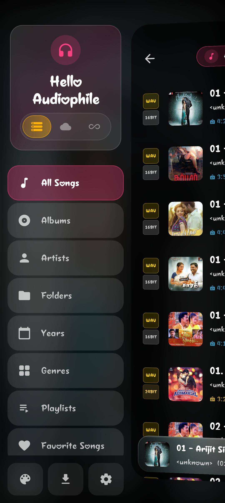
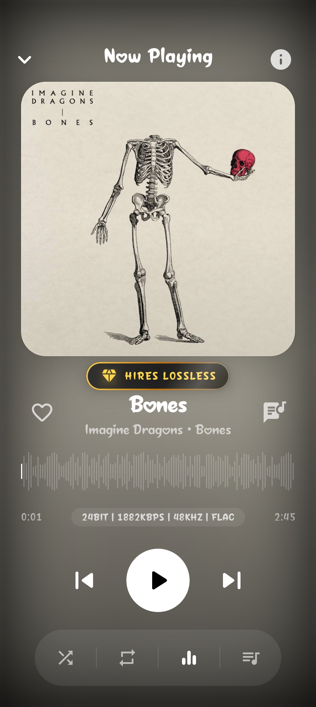
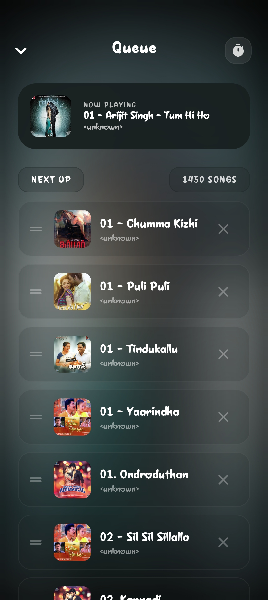
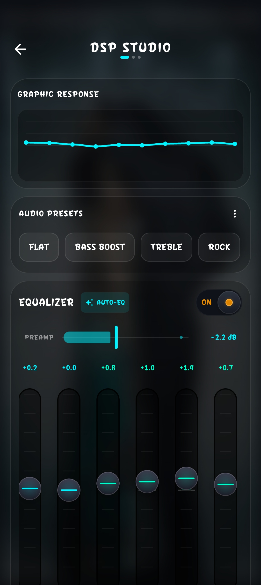
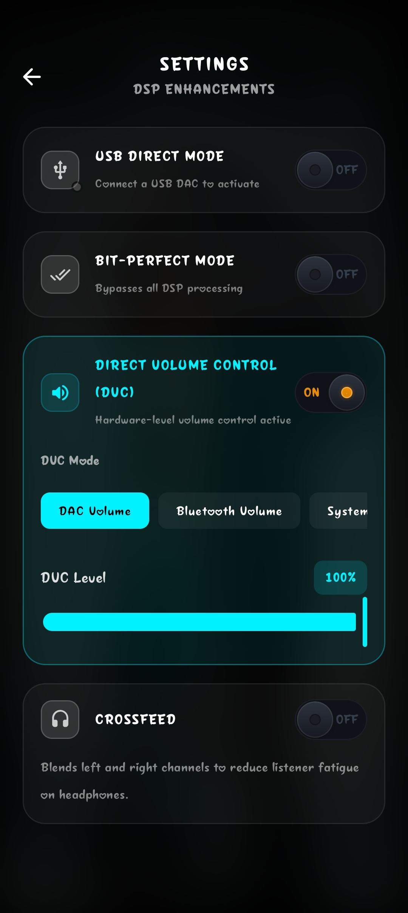
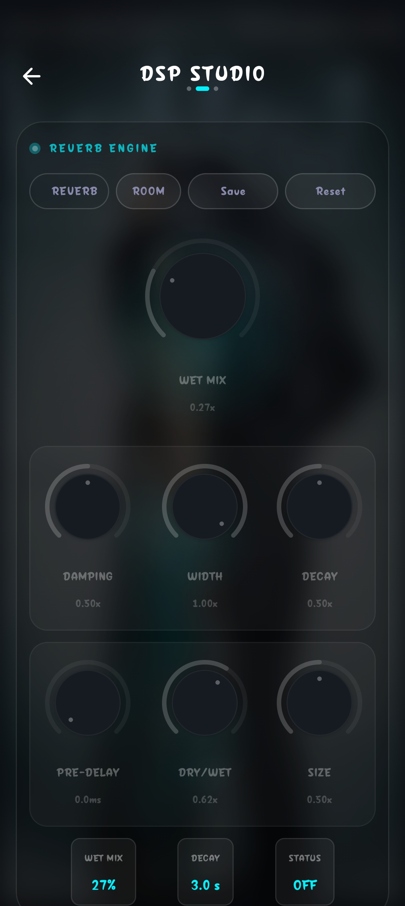
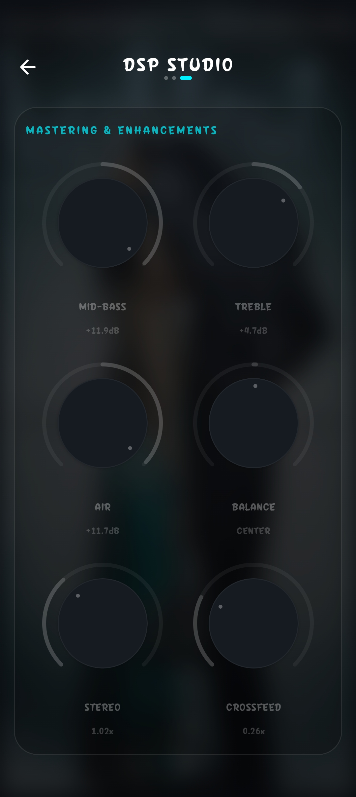
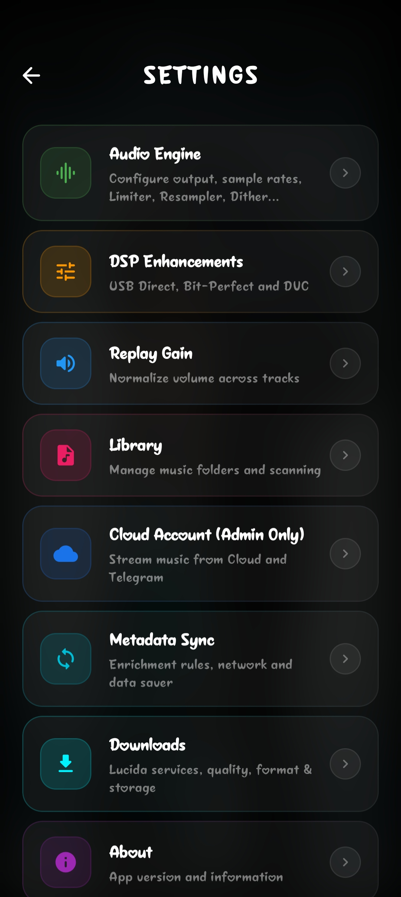

# Beatraxus

**A high-fidelity Android music and video player with a custom native audio engine, a full studio-style DSP chain, cloud and network library support, and an add-on system for streaming sources.**

Beatraxus is a native Android app written in Kotlin (Jetpack Compose) with a C++ DSP core. It plays your local files, cloud drives, NAS shares and online sources through its own audio pipeline instead of the stock Android player, so EQ, resampling, spatial processing and dithering all happen before the signal reaches your DAC or headphones.

| | |
|---|---|
| **Package** | `com.beatraxus.app` |
| **Version** | `3.3.7-stable` (versionCode 8) |
| **Min / Target SDK** | 26 (Android 8.0) / 36 |
| **Language** | Kotlin 2.4 + C++17 (NDK 29) |
| **UI** | Jetpack Compose, Material 3 |
| **Build** | Gradle (AGP 9.3), single `:app` module |
| **ABIs** | `arm64-v8a`, `armeabi-v7a` (+ universal APK) |

---

## Screenshots

| Home | Now Playing | Queue |
|---|---|---|
|  |  |  |

| EQ | DSP | Reverb |
|---|---|---|
|  |  |  |

| Mastering | Settings |
|---|---|
|  |  |

---

## Features

### Audio engine
- **Custom playback pipeline**: decoder → ring buffer → DSP chain → audio output, driven by `AudioEngine` with gapless playback and crossfade.
- **Multiple output paths**: standard AAudio, a "HiFi" direct high-resolution path, and **MMAP Exclusive** (low-latency AAudio MMAP). Also supports USB exclusive mode and **bit-perfect** output (DSP bypassed).
- **Decoders**: Android `MediaCodec` first, with automatic fallback to FFmpeg (FFmpeg Kit + Media3 FFmpeg extension) for ALAC, AC3/EAC3, DTS and other formats the platform can't decode. Tracks that repeatedly fail on MediaCodec are routed to FFmpeg.
- **DSD support**: DoP packing and DSD-to-PCM conversion in native code.
- **Output formats**: 16 / 24 / 32-bit integer and 32-bit float, sample rates from 44.1 kHz to 192 kHz, optional 64-bit float processing.
- **High-quality resampling** with SoXR (bundled in `app/src/main/cpp/soxr`), with selectable quality and cutoff.
- **Dither**: TPDF, noise-shaped and high-pass options.
- **ReplayGain** (track/album), DC blocker, look-ahead limiter (soft and hard modes), dynamic volume control, RMS leveler.
- **Speed control** with optional pitch preservation, mono downmix, A–B loop.

### Studio DSP (native C++)
Implemented in `app/src/main/cpp/SpecialDSP.cpp` and exposed through JNI (`NativeDsp`):
- **Parametric EQ** with per-band frequency, gain, Q and filter type, minimum- or linear-phase mode, and automatic headroom management.
- **AutoEQ headphone profiles** (bundled `autoeq_profiles.json`) with in-app search.
- **Tone controls** (bass / treble / air), preamp, balance and stereo widening.
- **Reverb**: Freeverb-based engine with presets, pre-delay, width, damping and room size.
- **Crossfeed** (Bauer stereo-to-binaural).
- **3D sound stage / spatial engine**: 8-band LR4 crossover with per-band panning, distance, depth and HRTF-style cues (Natural Balanced, Natural Wide, Cinematic, Studio), plus a cinema mode. A bundled default HRTF file lives in `assets/hrtf`.
- **5.1 / 7.1 surround upmixer** (stereo → multichannel) with Movie / Music / Game / Custom modes and per-channel trims. See [`docs/SURROUND_SIMULATOR.md`](docs/SURROUND_SIMULATOR.md).
- **Signal path inspector**: a sheet showing every stage the audio passes through for the current track.

### Smart / AI features (on-device)
- **AI EQ**: an offline per-song EQ predictor. It infers genre, mood and language from tags and file names, then (for local files) measures the real spectrum, loudness and dynamics to correct the curve for that specific recording. It always falls back to a neutral curve rather than failing.
- **Natural-language EQ assistant** (`NlEqAssistant`) for describing the sound you want.
- **TensorFlow Lite analysis** for genre, language and mood. Model files are not shipped; drop them in `app/src/main/assets/models/` (see the readme there).
- **Quality scoring, intro/outro detection, song profiling** and smart library grouping / smart playlists.

### Library and sources
- **Local library** via MediaStore scanning, with folder browsing, albums, artists, genres, playlists, favorites and recently played (Room database).
- **Cloud drives**: Google Drive, Dropbox, OneDrive, Box, Nextcloud (WebDAV).
- **Network shares**: SMB/CIFS, FTP and SFTP browsers.
- **Telegram** channels as a media source (via TDLib).
- **Internet radio** (Radio Browser API) and **Live TV** (user-supplied M3U playlists).
- **Cast / DLNA**: Google Cast support and a DLNA sheet; a local HTTP server feeds files to cast targets.
- **Tag editor**, ringtone helper, embedded and online album art, artist art and biographies.
- **Encrypted backup and restore** of settings and data.

### Lyrics
- Embedded lyrics, local `.lrc` files and a multi-provider online lookup with a matcher and validator to reject bad results. Providers in the codebase include LRCLIB, Kugou, YouTube Music, YouTube Captions, SimpMusic, Betterlyrics, Lyricsplus, BiniLyrics, Paxsenix, Unison and Megalobiz.
- Karaoke-style word/line highlighting view.

### Video player
- Media3 ExoPlayer with HLS and DASH, custom audio renderers and A/V delay adjustment.
- **Audio routed through the Beatraxus DSP** for video playback.
- **Subtitles**: OpenSubtitles search and download, hash-based matching, encoding normalization, delay shifting and positioning.
- **FPS Booster**: GPU optical-flow frame interpolation (45 / 60 / 90 / 120 FPS targets), with adaptive quality, thermal monitoring and a benchmark tool. See [`docs/FPS_BOOSTER.md`](docs/FPS_BOOSTER.md) for its status and limitations.
- **Color grading** and thumbnail sprite generation for seek previews.
- Cloud, Telegram and add-on sources are playable as video too.
- **Open network stream**: paste an http(s) link to a video file, HLS (`.m3u8`) or DASH (`.mpd`) stream from the video home screen and play it directly; the same link remembers its resume position.

### Play Together
Listen in sync with friends. Each phone plays the matching song from its own library (matched by title, artist and duration), and the room keeps playback synchronized via Firebase Realtime Database (REST + server-sent events, no Firebase SDK). Phones that lack the song can receive it through peer-to-peer transfer (WebRTC data channel), Nearby (Bluetooth / Wi-Fi Direct) or a local Wi-Fi hotspot route.

### Add-ons
A manifest-based add-on system for streaming sources. Built-in protocols: **Subsonic** (Navidrome, Airsonic, Gonic), **Jellyfin**, **Emby**, **Plex** (limited), **Stremio** catalogs, **Jamendo**, **Internet Archive** and **YouTube**. Ready-to-install ZIPs are in [`addons/dist`](addons/dist); see [`addons/README.md`](addons/README.md) and [`addons/JAMENDO.md`](addons/JAMENDO.md).

### Personalization
- Home-screen widgets (Jetpack Glance) in several sizes.
- Multiple seekbar styles (Matrix, Pulse, Comet, Prism, Thread, waveform, spectrum timeline and more).
- 50+ bundled fonts, custom DSP color palettes and glass/blur UI effects.
- Last.fm scrobbling and metadata.

---

## Architecture

```
app/src/main/
├── java/com/beatraxus/app/
│   ├── MainActivity.kt, BeatraxusApplication.kt
│   ├── ui/            Compose screens, components, theme (MainScreen, NowPlayingScreen, DspScreen, ...)
│   ├── viewmodel/     PlayerViewModel, VideoPlayerViewModel
│   ├── service/       AudioPlaybackService (Media3 session + foreground service)
│   ├── engine/        AudioEngine, decoders, DspPipeline, NativeDsp (JNI), outputs, analysis
│   │   ├── aieq/      Offline AI EQ
│   │   └── smart/     Song profiling, genre taxonomy, library grouping
│   ├── repository/    Library, lyrics, cloud accounts, backup, Last.fm, radio, AutoEQ
│   ├── model/         Room entities/DAOs (AppDatabase) and DSP/surround config models
│   ├── drive/         Cloud scanners and streaming/caching (Drive, Dropbox, OneDrive, Box, Nextcloud)
│   ├── addons/        Add-on manager, installer and protocol clients
│   ├── features/      Play Together, DLNA, tag editor, A-B loop, smart playlists, ringtone
│   ├── fpsbooster/    Optical-flow interpolation (GL renderer, planner, adaptive quality)
│   ├── motionboost/   Original GPU frame-boost renderer
│   ├── colorgrade/    Color grading effect for video
│   ├── subtitles/     OpenSubtitles API, matching, cache, UI
│   ├── telegram/      TDLib wrapper and data sources
│   ├── cast/          Google Cast integration
│   ├── livetv/        M3U live TV
│   └── widget/        Glance home-screen widgets
├── cpp/
│   ├── SpecialDSP.cpp  Native DSP: EQ, spatial, reverb, limiter, resampling, analysis, MMAP output
│   └── soxr/           Bundled SoXR resampler
└── assets/            AutoEQ profiles, HRTF, FPS Booster shaders, TFLite model folder
```

**Audio flow:** `AudioEngine` decodes through `DecoderFactory`, buffers PCM, runs it through `AudioDspPipeline` (native chain, then the optional surround upmixer) and writes to an `AudioOutput` implementation (`AudioTrackOutput` or `MmapAudioOutput`). `AudioPlaybackService` hosts the engine and exposes it to the system through a Media3 session, notification and widgets.

**Tech stack:** Kotlin, Coroutines/Flow, Jetpack Compose, Room (KSP), DataStore, WorkManager, Media3 (ExoPlayer, session, effect, HLS, DASH), Retrofit/OkHttp, Coil, TensorFlow Lite, FFmpeg Kit, TDLib, WebRTC, Google Play Services (Cast, Auth, Nearby), and SDKs for Dropbox, Microsoft Graph, Box, SMBJ, SSHJ and Sardine.

---

## Building from source

### Requirements
- Android Studio (recent) or command-line Gradle (wrapper included)
- JDK 17
- Android SDK 36, NDK `29.0.14206865`, CMake `3.31.0`
- A signing keystore (the build requires one, even for debug)

### 1. Create `local.properties`
The build **fails** if the required keys are missing:

```properties
# Required
LASTFM_API_KEY=...
LASTFM_SECRET=...
RELEASE_STORE_FILE=/path/to/keystore.jks
RELEASE_STORE_PASSWORD=...
RELEASE_KEY_ALIAS=...
RELEASE_KEY_PASSWORD=...

# Optional (features degrade gracefully when empty)
TELEGRAM_API_ID=
TELEGRAM_API_HASH=
PAXSENIX_API_KEY=
DROPBOX_APP_KEY=
ONEDRIVE_CLIENT_ID=
BOX_CLIENT_ID=
BOX_CLIENT_SECRET=
GOOGLE_CLIENT_ID=
GOOGLE_WEB_CLIENT_ID=
TMDB_API_KEY=
OPENSUBTITLES_API_KEY=
JAMENDO_CLIENT_ID=
LLM_API_KEY=
LLM_ENDPOINT=https://api.openai.com/v1/chat/completions
LLM_PROVIDER=openai
LLM_MODEL=gemini-2.0-flash
# Auto-generated video subtitles (speech recognition). Needs an OpenAI-style
# /audio/transcriptions endpoint that returns verbose_json (OpenAI whisper-1, Groq, self-hosted Whisper).
# Translating the generated subtitles uses the LLM_* keys above (a chat-completions endpoint).
# Free plans cap the audio seconds per hour. To avoid stopping at that limit, SPEECH_API_KEY and SPEECH_MODEL each
# accept several comma-separated values; the app uses the first and switches to the next the moment one is limited,
# and only waits when every one is limited. A shorter list repeats its last value. Examples (Groq counts the limit per
# model, so one key with two models already doubles it; extra keys from other accounts add more):
#   SPEECH_API_KEY=gsk_keyA,gsk_keyB
#   SPEECH_MODEL=whisper-large-v3-turbo,whisper-large-v3
SPEECH_API_KEY=
SPEECH_ENDPOINT=https://api.openai.com/v1/audio/transcriptions
SPEECH_MODEL=whisper-1
```

### 2. Add `google-services.json`
Place the file from your Firebase console at `app/google-services.json`. It is copied into the app assets before each build and is used by Play Together at runtime. (The Gradle task `copyGoogleServices` runs on every build, so the file must exist.)

### 3. Optional: TFLite models
Place `yamnet.tflite`, `genre_model.tflite`, `language_model.tflite` and `mood_model.tflite` in `app/src/main/assets/models/` to enable the on-device genre/language/mood analysis.

### 4. Build

```bash
./gradlew assembleDebug      # debug build (signed with the release config)
./gradlew assembleRelease    # minified, resource-shrunk release build
./gradlew testDebugUnitTest  # unit tests
```

Output APKs are named `Beatraxus-v<version>-<abi>-<variant>.apk`.

### CI
`.github/workflows/release.yml` builds signed release APKs on manual dispatch or on tags matching `v*`. It needs the GitHub secrets for the Last.fm keys and the keystore (`KEYSTORE_BASE64`, `RELEASE_STORE_PASSWORD`, `RELEASE_KEY_ALIAS`, `RELEASE_KEY_PASSWORD`).

---

## Testing

Unit tests live in `app/src/test` and cover the audio engine (EQ calculator, resampler, surround upmixer, ring buffer, spectrum analyzer), lyrics parsing/matching, subtitles, add-on APIs, Play Together sync math, FPS Booster planning and pacing, and backup encryption.

Offline tooling in [`tools/`](tools):
- `tools/fpsbooster_harness/`: Python harness that scores interpolation engines (PSNR/SSIM) on ground-truth clips.
- `tools/spatial_engine_test/` and `tools/test_classic_engine.py`: offline accuracy tests for the spatial engine's classic mode.

---

## Permissions

Media read access (audio/video), notifications, foreground service (media playback, data sync), wake lock, Bluetooth and Nearby/Wi-Fi permissions (for Play Together local transfer and audio routing), network state, and a battery-optimization exemption request to keep playback alive in the background. `WRITE_SETTINGS` is declared for ringtone setting.

---

## Add-on development

An add-on package is a ZIP with a single `manifest.json` at its root:

```json
{
  "id": "preset_jamendo",
  "displayName": "Jamendo Music",
  "mediaType": "audio",
  "protocol": "jamendo",
  "authType": "api_key"
}
```

The `id` may only contain letters, digits and `_`. Copy a folder under `addons/`, edit the manifest, and run `python3 addons/build_zips.py` to rebuild and validate all ZIPs against the app's install rules.

---

## Known notes

- The FPS Booster doc states the optical-flow booster was validated on a desktop GPU emulator and unit tests, and should be verified on real devices.
- Plex is intentionally excluded from the shipped add-on ZIPs because its add-on can't sign in yet.
- `BaseGlShaderProgram.java` and `SingleFrameGlShaderProgram.java` in the repo root are copies of Media3 sources and are not compiled.
- No `LICENSE` file is present in the repository; add one before accepting contributions or redistributing.

---

## Credits and attribution

Beatraxus bundles or uses [SoXR](https://sourceforge.net/projects/soxr/) (LGPL), FFmpeg Kit, Jetpack/Media3, TDLib, and many fonts under open licenses. Online data comes from LRCLIB and other lyrics providers, Deezer, Apple iTunes Search, Wikipedia (CC BY-SA 4.0), Jamendo, Internet Archive, OpenSubtitles, Last.fm and Radio Browser. Full attribution text is in [`ATTRIBUTION.md`](ATTRIBUTION.md).
